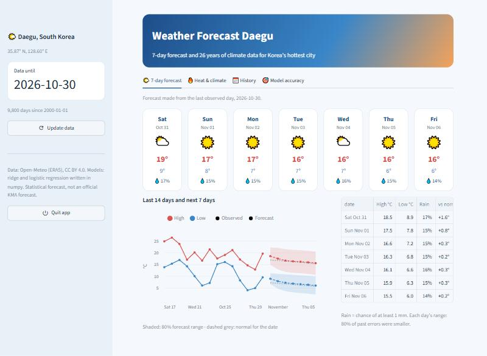
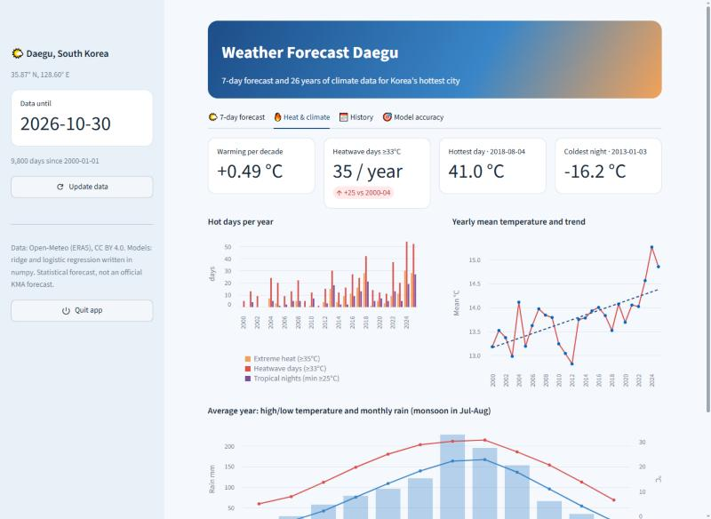
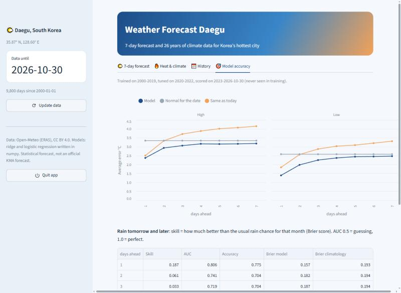

# Weather Forecast Daegu

Daily weather forecasting and climate analysis for **Daegu, South Korea**, built with **pandas and
numpy**. The forecast models (ridge regression and logistic regression) are written from scratch in
numpy and tested honestly against simple baselines on years they never saw.



## Highlights

- **26 years of daily data** (2000 to today, 9,800 days): temperature, rain, snow, wind, humidity,
  pressure and sunshine.
- **Data checked against the real Daegu weather station** (WMO 47143): daily mean temperature
  correlation **0.997**, average difference 0.85 °C.
- **Korea's hottest city, measured**:
  - warming of **+0.49 °C per decade** since 2000;
  - heatwave days (max ≥ 33 °C) went from **10 per year in 2000-04 to 35 per year in 2021-25**;
  - hottest day **41.0 °C** (2018-08-04), wettest day 129 mm (2003-09-12, Typhoon Maemi);
  - about half of the yearly rain falls in summer (Jangma monsoon).
- **7-day forecast** of daily high, low and chance of rain, with 80% ranges.
- Streamlit dashboard and a double-click **`WeatherDaegu.exe`**.



## How the forecast works

| Step | File | What it does |
|---|---|---|
| Data | `weather/data.py` | Downloads and cleans the history with pandas: units, valid ranges, one row per day, short gaps filled; updates only the new days |
| Check | `scripts/check_station.py` | Compares the data with real station measurements |
| Climate | `weather/climate.py` | Monthly normals, heatwave days, tropical nights, rain, warming trend (`np.polyfit`), records |
| Features | `weather/features.py` | Today's temperatures as anomalies from a fitted seasonal normal, 7-day average, pressure and its change, humidity, recent rain, sunshine, wind, season |
| Models | `weather/models.py` | Ridge regression (closed form) and logistic regression (gradient descent), standardisation, MAE, Brier score and ROC AUC, all in numpy |
| Training | `weather/forecast.py` | One model per target and day ahead (1-7); penalty chosen on validation years |

**Time split, no shuffling:** train 2000-2019, choose the penalty on 2020-2022, final test on
**2023 to today** (about 1,400 days the models never saw).

## Results on the test years (2023 to today)

Average error of the daily **low** temperature (°C, lower is better):

| Days ahead | 1 | 2 | 3 | 5 | 7 |
|---|---|---|---|---|---|
| **Model** | **1.39** | **1.98** | **2.25** | **2.44** | **2.47** |
| Same as today | 1.84 | 2.56 | 2.87 | 3.09 | 3.31 |
| Normal for the date | 2.58 | 2.58 | 2.58 | 2.58 | 2.58 |

Average error of the daily **high** temperature (°C):

| Days ahead | 1 | 2 | 3 | 5 | 7 |
|---|---|---|---|---|---|
| **Model** | **2.37** | **2.93** | **3.06** | **3.15** | **3.18** |
| Same as today | 2.50 | 3.33 | 3.71 | 4.01 | 4.15 |
| Normal for the date | 3.34 | 3.34 | 3.34 | 3.34 | 3.34 |

**Rain tomorrow** (at least 1 mm): AUC **0.81**, 77.5% correct, Brier score **19% better** than the
usual rain chance for that month. The advantage shrinks with each day ahead (skill 6% on day 2,
about 1% on day 7), which is expected without weather-map data.

The model beats both baselines at every horizon. Adding season features improved rain AUC from
0.78 to 0.81. Full numbers: `docs/metrics.json`.



## Setup (Windows)

1. Install Python 3.11+ (64-bit).
2. Double-click `INSTALL_WINDOWS.bat` (installs pandas, numpy and Streamlit).
3. Double-click **`WeatherDaegu.exe`**. The dashboard opens in your browser; it runs only on your PC.
   Use **Update data** in the sidebar to download the newest days, and **Quit app** to stop.

Windows SmartScreen may warn once because the exe is not code-signed: **More info → Run anyway**.

Command line:

```bat
.venv\Scripts\python.exe -m weather.data               & rem download / update the data
.venv\Scripts\python.exe -m weather.climate            & rem climate statistics
.venv\Scripts\python.exe -m weather.forecast evaluate  & rem measure the models
.venv\Scripts\python.exe -m weather.forecast predict   & rem 7-day forecast
.venv\Scripts\python.exe -m unittest discover -s tests -t .
.venv\Scripts\python.exe -m streamlit run app.py
```

## Project structure

```text
Weather_Forecast_Daegu/
├── app.py                    # Streamlit dashboard
├── WeatherDaegu.exe          # Double-click launcher
├── weather/
│   ├── data.py               # Download, clean, update
│   ├── climate.py            # Normals, heatwaves, trends, records
│   ├── features.py           # Feature engineering with pandas
│   ├── models.py             # Ridge + logistic regression in numpy
│   ├── forecast.py           # Training, evaluation, 7-day forecast
│   └── config.py
├── scripts/check_station.py  # Data check against the Daegu station
├── data/daegu_daily.csv      # Cleaned daily history
├── docs/                     # Metrics, climate summary, screenshots
├── tests/test_models.py
└── launcher/                 # Exe source, icon and build script
```

## Limitations

- This is a **statistical forecast from one location's history**. Official forecasts (KMA) use
  physics-based models with satellite and weather-map data and are more accurate, especially for rain.
- The history is ERA5 reanalysis for the Daegu area, not a single thermometer; it reads about
  0.6 °C cooler than the city-centre station on average, so heatwave counts are slightly conservative.
- The archive is about 2 days behind today, so the 7-day forecast starts from the last available day.

## Credits and licenses

- Code: MIT (see `LICENSE`).
- Weather data: [Open-Meteo](https://open-meteo.com/) Historical Weather API, ERA5 reanalysis
  (CC BY 4.0).
- Station check: [Meteostat](https://meteostat.net/) daily data for Daegu (WMO 47143, CC BY-NC 4.0),
  used only for validation, not stored in the repo.
- Heatwave threshold follows the Korea Meteorological Administration (KMA) warning level of 33 °C.
